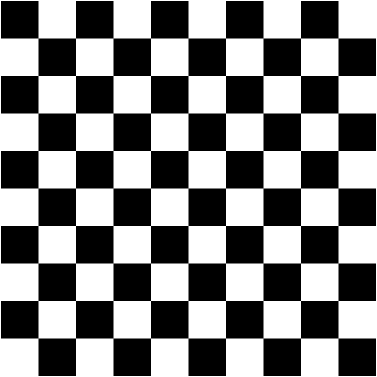

# NLA - Challenge 2
**Goal**: Apply the singular value decomposition to image compression and noise reduction.

**Data**: Download the file [deer.jpg](res/deer.jpg) from webeep and move it to your working directory.

**Tasks**:
1. **Q**: Load the image as an Eigen matrix A with size $m\times n$. Each entry in the matrix corresponds to a pixel on the screen and takes a value somewhere between $0$ (black) and $255$ (white). Compute the matrix product $A^TA$ and report the euclidean norm of $A^TA$.

   **A**: 

2. **Q**: Solve the eigenvalue problem $A^T Ax = \lambda x$ using the proper solver provided by the Eigen library. Report the two largest computed singular values of $A$.

   **A**: 

3. **Q**: Export matrix $A^T A$ in the matrix market format and move it to the `lis-2.1.10_test` folder. Using the proper iterative solver available in the LIS library compute the largest eigenvalue of $A^TA$ up to a tolerance of $10^{−10}$. Report the computed eigenvalue. Is the result in agreement with the one obtained in the previous point?

   **A**:

4. **Q**: Find a shift $\mu \in \mathbb{R}$ yielding an acceleration of the previous eigensolver. Report $\mu$ and the number of iterations required to achieve a tolerance of $10^{-10}$

   **A**: 

5. **Q**: Using the SVD module of the Eigen library, perform a singular value decomposition of the matrix $A$. Report the Euclidean norm of the diagonal matrix $\Sigma$ of the singular values.

   **A**: 

6. **Q**: Compute the matrices $C$ and $D$ described in (1) (look at PDF) assuming $k = 30$ and $k = 90$. Report the number of nonzero entries in the matrices $C$ and $D$.

   **A**: 

7. **Q**: Compute the compressed images as the matrix product $CD^T$ (again for $k = 30$ and $k = 90$). Export and upload the resulting images in `.png`.

   **A**: 

8. **Q**: Using Eigen create a black and white checkerboard image (as the one depicted below) with height and width equal to $400$ pixels. Report the Euclidean norm of the matrix corresponding to the image.

   

   **A**: 

9. **Q**: Introduce a noise into the checkerboard image by adding random fluctuations of color ranging between $[−60, 60]$ to each pixel. Export the resulting image in `.png` and upload it.

   **A**: 

10. **Q**: Using the SVD module of the Eigen library, perform a singular value decomposition of the matrix corresponding to the noisy image. Report the two largest computed singular values.

    **A**: 

11. **Q**: Starting from the previously computed SVD, create the matrices $C$ and $D$ defined in (1) assuming $k = 6$ and $k = 12$. Report the size of the matrices $C$ and $D$.

    **A**: 

12. **Q**: Compute the compressed images as the matrix product $CD^T$ (again for $k = 6$ and $k = 12$). Export and upload the resulting images in `.png`.

    **A**: 

13. **Q**: Compare the compressed images with the original and noisy images. Comment the results.

    **A**: 